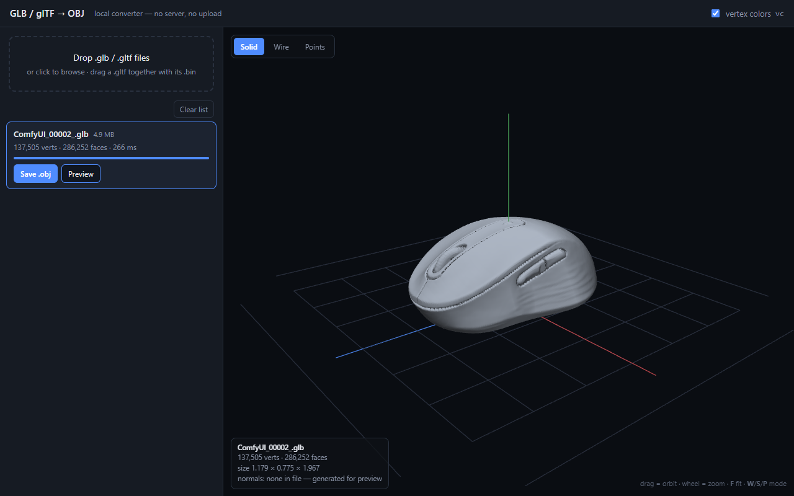

# glb2obj

**One HTML file. Double-click it, drop a `.glb`, get a `.obj`.** No install, no server, no
upload, no dependencies — the whole converter and a 3D preview live in `glb2obj.html`
(56 KB) and run in whatever browser you already have.



> **Vibecoded.** Design, feature choices and every judgement call (what to keep, what to
> drop, how it looks) were made by me; the code was written by an AI coding agent
> ([pi](https://github.com/badlogic/pi-mono)) driving the iterations, the tests and the
> browser checks.

## Use it

1. Double-click **`glb2obj.html`** — it opens in your browser. That is the entire app.
2. Drag one or more `.glb` / `.gltf` files onto the page. They convert immediately and each
   row gets **Save .obj**.

Try it with [`sample-mouse.glb`](sample-mouse.glb) in this repo (4.9 MB, generated in
ComfyUI): drop it on the page and the row reads

```
137,505 verts · 286,252 faces · 266 ms
```

Click **Preview** for the view in the screenshot above — orbit with the mouse, wheel to
zoom, then hit `W` (wireframe), `S` (solid), `P` (points) or `F` (refit). **Save .obj**
writes a 10.4 MB file: 137,505 `v` lines and 286,252 `f v/vn` lines, Y-up, no axis flip.

If a `.gltf` references external buffers, drop it **together with** its `.bin` file(s).

## What comes out

| Your file has | The OBJ gets |
| --- | --- |
| points / point cloud | `v` lines |
| triangle meshes (indexed or not) | `f` lines, correct global index offsets |
| `NORMAL` | `vn` lines, transformed into world space |
| `COLOR_0` | `vc` lines (Blender's vertex-colour extension) — untick *vertex colors* to skip |
| node hierarchy | all transforms baked into the vertex positions |
| `KHR_draco_mesh_compression_ext` | decoded first (see below) |

Textures and materials are not exported (no `.mtl`), morph targets and skinning are not
animated, and no axis flip is applied. When your model has UVs or skinning the status line
says so instead of failing silently, so you always know what you lost.

## Draco files (only if your model is compressed)

Draco needs Google's WASM decoder, which is deliberately not inlined (1.4 MB of base64 for a
feature most files never use). On the first Draco model the page fetches it from Google's
CDN. To work fully offline: drop `draco_decoder_gltf.js` and `draco_decoder_gltf.wasm`
onto the page once, then retry the model.

## Under the hood (there isn't much)

- Parse + convert is one plain-JS block, no libraries, time-sliced so a 100 MB mesh never
  freezes the tab and stays cancellable.
- OBJ text is emitted in ≤1 MB chunks instead of one giant string — that 10.4 MB output
  above is 74 chunks, and memory stays bounded.
- Preview is hand-written WebGL (no three.js — it has to stay one file).

### Hacking on it

```
node dev/test.mjs        # 21 checks, runs in Node, no dev dependencies
```

The harness extracts the `CORE` block straight out of the HTML, so the browser code and the
tested code are literally the same bytes. It includes a golden check that the OBJ is
**byte-identical** to the old Node converter on `sample-mouse.glb`, an interleaved-`byteStride`
regression, and a real Draco decode. `dev/make-fixtures.mjs` builds the small test fixtures
on demand (they are not committed); `dev/make-draco-fixture.mjs` regenerates
`dev/fixtures/draco-bunny.glb`, which is committed because it needs a real Draco encoder.

## License

MIT — see [LICENSE](LICENSE).
